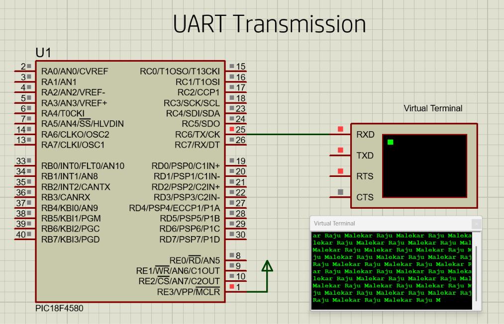
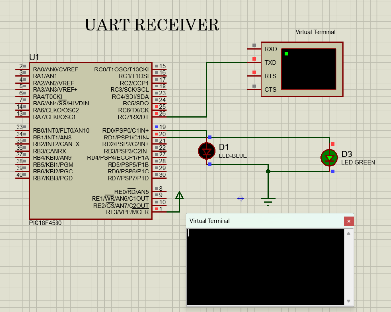

# PIC18F4580 UART Communication

This repository contains UART/EUSART communication projects using the
PIC18F4580 microcontroller.

The projects demonstrate UART transmission using a character array and
pointer, and UART reception using an interrupt to control two LEDs.

## Tools & Technologies

- Microcontroller: PIC18F4580
- Programming Language: Embedded C
- Compiler: MPLAB C18
- Simulation: Proteus
- Communication: UART / EUSART
- Baud Rate Generator: SPBRG
- UART Pins: RC6/TX and RC7/RX

## Project Structure

```text
PIC18F4580-UART/
│
├── UART_Transmission/
│   ├── uart_transmission.c
│   └── uart_transmission.png
│
├── UART_Receiver_Interrupt/
│   ├── uart_receiver_interrupt.c
│   └── uart_receiver_interrupt.png
│
└── README.md
```

## 1. UART Transmission

The PIC18F4580 continuously transmits the string:

```text
Raju Malekar
```

The program uses a character array and a pointer to transmit each
character through the RC6/TX pin.

### Main concepts

- EUSART initialization
- Asynchronous transmission
- High-speed mode
- `TXIF` polling
- `TXREG` transmission
- Character arrays
- Character pointers
- Proteus Virtual Terminal

### Proteus Simulation



---

## 2. UART Receiver with Interrupt

The second project uses the UART receive interrupt to control two LEDs.

### LED Commands

| Received Character | Action |
|---|---|
| `1` | LED1 ON |
| `0` | LED1 OFF |
| `A` or `a` | LED2 ON |
| `B` or `b` | LED2 OFF |

### Pin Configuration

| PIC18F4580 Pin | Function |
|---|---|
| RC6/TX | UART Transmitter |
| RC7/RX | UART Receiver |
| RD0 | LED1 |
| RD1 | LED2 |

### Interrupt Configuration

```c
PIE1bits.RCIE = 1;
INTCONbits.PEIE = 1;
INTCONbits.GIE = 1;
```

When a character is received, the UART receive interrupt is generated.
The ISR reads the character from `RCREG` and controls the appropriate LED.

### Proteus Simulation



---

## UART Communication Flow

```text
              UART TRANSMITTER
                    │
                    │ RC6/TX
                    ↓
              Serial Data
                    │
                    ↓
              RC7/RX
                    │
                    ↓
             UART RECEIVER
                    │
                    ↓
              Receive ISR
                    │
              ┌─────┴─────┐
              ↓           ↓
            LED1          LED2
```

## UART Registers Used

### TXSTA

Controls the transmitter configuration, including:

- Transmit enable
- Asynchronous mode
- High-speed baud-rate selection

### RCSTA

Controls the serial port and receiver.

### SPBRG

Sets the baud-rate generator value.

### TXREG

Holds the character to be transmitted.

### RCREG

Contains the received character.

### TXIF

Indicates that `TXREG` is ready for new data.

### RCIF

Indicates that a character has been received.

---

## Learning Objectives

- Understand PIC18F4580 EUSART
- Configure UART transmission
- Configure UART reception
- Use `TXIF` for polling-based transmission
- Use `RCIF` for receive detection
- Implement UART receive interrupts
- Work with character arrays and pointers
- Control GPIO outputs using received UART commands
- Verify UART communication using Proteus Virtual Terminal

## Author

Raju Malekar

Electronics Engineer | Embedded Systems Enthusiast

Areas of interest:
- Embedded C
- PIC Microcontrollers
- UART / EUSART
- Interrupts
- Timers
- ADC
- PWM
- LCD Interfacing
- Embedded Systems
- Proteus Simulation
